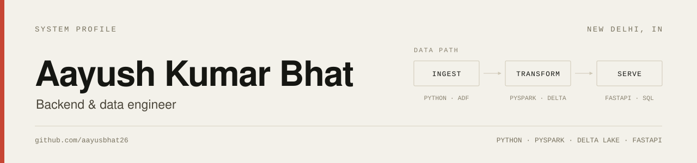

  <picture>
    <source media="(prefers-color-scheme: dark)" srcset="assets/banner-dark.svg">
    
  </picture>

Backend and data engineer. I build services and pipelines that stay correct when data is late, duplicated, or malformed: Python and FastAPI on the serving side, PySpark and Delta Lake on the processing side, Kafka in between.

**Now** — Associate Software Engineer at Nagarro, Gurugram  
**Focus** — Full stack development and data engineering  
**Open to** — remote backend and data engineering roles

---

### 01 / Selected systems

**HVAC Telemetry Lakehouse**  
Aiven Kafka over TLS → Delta Lake medallion pipeline in PySpark → gold layer served by FastAPI on DuckDB, with Z-Ordering on the tables the API filters.  
[Code](https://github.com/aayusbhat26/poc_latency_test)

**Globe News Atlas**  
Ten public sources → bronze/silver/gold Parquet lake on Hugging Face → FastAPI → React/Three.js globe.  
[Live](https://globe-news-atlas.onrender.com/) · [Code](https://github.com/aayusbhat26/globe_news_atlas)

**TaskFlow**  
Chat-native work OS spanning 62 Prisma models, with Socket.IO presence, threads, reactions, and one Docker service on Render.  
[Live](https://taskflow-render.onrender.com/en) · [Code](https://github.com/aayusbhat26/task_flow)

### 02 / Open source

**[apache/iceberg-python #4169](https://github.com/apache/iceberg-python/pull/4169)** — merged. `list-refs` now emits one JSON object per ref, so CLI output parses cleanly downstream.

### 03 / How I build

| # | Stage | Tooling |
|---|-------|---------|
| 01 | Sources | APIs · feeds · telemetry |
| 02 | Ingest | Python · Kafka · Azure Data Factory |
| 03 | Storage | Parquet · Delta Lake |
| 04 | Transform | PySpark · DuckDB · SQL |
| 05 | Quality | tests · quarantine · watermarks |
| 06 | Serve | FastAPI · Power BI |

Correctness before dashboards: I write the data-quality checks before the reporting layer.

### 04 / Writing

- [Sub-second OLAP without a warehouse: DuckDB + FastAPI](https://dev.to/aayusbhat26/sub-second-olap-without-a-warehouse-duckdb-fastapi-4m7d)
- [Watermarks are a contract: validating 150+ PySpark streams](https://dev.to/aayusbhat26/watermarks-are-a-contract-validating-150-pyspark-streams-5dj5)
- [How to integrate Clerk in a Next.js application](https://dev.to/aayusbhat26/how-to-integrate-clerk-in-next-js-application--4hba)
- [dev.to/aayusbhat26](https://dev.to/aayusbhat26)

### 05 / Stack

`Python` `SQL` `PySpark` `Delta Lake` `Kafka` `DuckDB` `Azure Data Factory` `Databricks` `AWS` `FastAPI` `PostgreSQL` `Prisma` `TypeScript` `React` `Docker` `GitHub Actions`

### 06 / Contact

[Portfolio](https://aayush-portfolio-390a.onrender.com/) · [LinkedIn](https://www.linkedin.com/in/aayush-kumar-bhat-/) · [LeetCode](https://leetcode.com/u/Aayush_Kumar_Bhat_08/) · [work.aayush.bhat@gmail.com](mailto:work.aayush.bhat@gmail.com)
